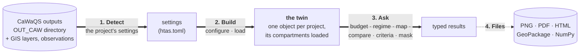

# HydrologicalTwinAlphaSeries

## The scientific backend of CaWaQS-ViZ

HydrologicalTwinAlphaSeries (HTAS) reads the outputs of a
[CaWaQS](https://gitlab.com/cawaqs) simulation and turns them into the
products a hydrologist works with: water budgets, hydrological regimes,
spatial maps, simulation-versus-observation comparisons with their
statistical criteria, and selections of a domain by a polygon (its internal
values and its river and aquifer boundaries). It returns typed results and
writes figures (PNG, PDF, HTML), GeoPackages and NumPy arrays.

HTAS has no user interface and needs no QGIS. It is the backend that
[CaWaQS-ViZ](https://gitlab.com/cawaqs/gviz/cawaqsviz), the QGIS plugin,
calls for every computation, and it can be used on its own: from Python, or
from the command line with `htas`.

> **Looking to read and explore your CaWaQS results in QGIS?** Use
> CaWaQS-ViZ, which installs HTAS for you:
> [CaWaQS-ViZ README](https://gitlab.com/cawaqs/gviz/cawaqsviz/-/blob/main/README.md),
> user guide in [English](https://github.com/flipoyo/user_guide_CaWaQS-Viz/blob/main/main_ENG.tex)
> or [French](https://github.com/flipoyo/user_guide_CaWaQS-Viz/blob/main/main_FR.tex).

## How it works



1. **Detect.** HTAS reads a CaWaQS `OUT_CAW` directory, and the QGIS
   project beside it if there is one, and finds the compartments, the
   simulated years, the layers and the observations.
2. **Build.** These settings build the *twin*: one object that holds the
   project's compartments (surface, river network, aquifer, ...), their
   meshes and their observations. Simulation outputs are read once and
   cached.
3. **Ask.** Each operation acts on the twin's compartments and returns a
   typed result: the data, the paths of the files it wrote, and what was
   computed.
4. **Files.** Figures, GeoPackages and arrays are written where the
   operation was told to write them.

HTAS can be driven at three levels:

- **`htas`**, the command line: it detects a project's settings, describes
  its twin, and runs each CaWaQS-ViZ operation as a command.
- **`HydrologicalTwinClient`**, in Python: one method per CaWaQS-ViZ
  operation, such as `budget_barplot` or `compare_sim_obs`. This is what
  CaWaQS-ViZ calls.
- **`HydrologicalTwin`**, in Python, for developers: the building blocks
  the operations are made of. There are nine verbs (`configure`, `load`,
  `describe`, `fetch`, `mask`, `transform`, `assemble`, `render`, `export`),
  and each one does one kind of work, chosen by a `kind`.

## Use cases

| Use case | Main entry points | Read |
|---|---|---|
| Find a project's compartments, years and layers from its CaWaQS outputs | `htas detect run`, `htas detect neighbors` | [API capabilities](docs/api_capabilities.md#command-line-l0) |
| Build a twin and list what it holds | `htas describe`, `HydrologicalTwinClient.build` | [API examples](docs/api_examples.md) |
| Plot the water budget of a compartment | `htas budget barplot`, `budget_barplot` | [API capabilities](docs/api_capabilities.md#client-operations-l1) |
| Plot the hydrological regime at observation points | `htas regime show`, `hydrological_regime` | [API capabilities](docs/api_capabilities.md#client-operations-l1) |
| Map the water balance or the aquifer budget | `htas map watbal`, `htas map aq`, `spatial_map_watbal`, `spatial_map_aq` | [API capabilities](docs/api_capabilities.md#client-operations-l1) |
| Compare simulation with observations, and compute the criteria | `htas compare simobs`, `htas criteria compute`, `compare_sim_obs`, `statistical_criteria` | [API capabilities](docs/api_capabilities.md#client-operations-l1) |
| Select a domain by a polygon: its values and its river and aquifer boundaries, as GeoPackages | `htas mask internal`, `htas mask hyd`, `htas mask aq`, `mask_internal_values`, `mask_hyd_boundary`, `mask_aq_boundary` | [API capabilities](docs/api_capabilities.md#client-operations-l1) |
| Build your own workflow from the verbs | `htas-dev fetch`, `htas-dev mask`, `htas-dev transform`, `htas-dev assemble`, `htas-dev render`, `htas-dev export`, or the verbs in Python | [API capabilities](docs/api_capabilities.md#developer-verbs-l2) |
| Use GIS layers from files, without QGIS | `FileGeoProvider` | [API examples](docs/api_examples.md#file-based-provider-and-the-command-line) |

## Installation

HTAS requires [Git](https://git-scm.com) and [Pixi](https://pixi.sh), and
runs only through Pixi:

```bash
git clone https://github.com/flipoyo/HydrologicalTwinAlphaSeries.git
cd HydrologicalTwinAlphaSeries
pixi install
pixi run htas --version
```

From there, Python scripts run with `pixi run python`, and the command line
with `pixi run htas` (and `pixi run htas-dev` for the developer verbs).

**Inside CaWaQS-ViZ.** CaWaQS-ViZ carries HTAS as a Git submodule, at
`external/HydrologicalTwinAlphaSeries`, and installs it at the plugin's
first launch. Nothing else is needed.

## Getting help

```bash
pixi run htas --help            # every command
pixi run htas detect --help     # one command: its subcommands, with an example each
pixi run htas --version         # the version and the build
```

`htas-dev` takes the same options: `pixi run htas-dev --help`. A mistyped
command gets a "did you mean". `--json` prints a command's result as JSON,
for scripts.

## Version and stability

HTAS follows [Semantic Versioning](https://semver.org) since `1.0.0`. The
version is in `pixi.toml`, and every commit and release is named
`HydrologicalTwinAlphaSeries-<version>`. The promise covers the public
interface: the `HydrologicalTwinClient` methods, the `HydrologicalTwin`
verbs and their kinds, the request and result types they exchange, and the
`htas` commands, their options, their exit codes and their `--json` output.

- **MAJOR** changes when that interface breaks: something is removed or
  renamed, or a result changes meaning.
- **MINOR** changes when something is added without breaking it: a method,
  a command, a kind, an optional field.
- **PATCH** changes for a fix that adds nothing.

Anything else, every module below the facade included, may change at any
version.

*AlphaSeries* names the series, not instability. HTAS is the first public
implementation of the HydrologicalTwin framework, the series in which its
core structures are defined and validated on real cases. The White Book,
in [docs/hydrological_twin](docs/hydrological_twin/), describes the whole
framework and says which part of it HTAS implements.

## Further reading

- [docs/api_capabilities.md](docs/api_capabilities.md): everything HTAS can
  do, at each of its three levels.
- [docs/api_examples.md](docs/api_examples.md): short examples to copy.
- [docs/domain_model.md](docs/domain_model.md): compartments, meshes,
  observations, extraction points.
- [docs/canonical_monolith.md](docs/canonical_monolith.md): why HTAS is one
  object, and its rules.
- [docs/hydrological_twin/](docs/hydrological_twin/): the user guide
  (`HTAS_user_guide.tex`) and the HydrologicalTwin White Book (`MASTER.tex`),
  in LaTeX. They are a repository of their own, fetched with the developer
  install.
- [docs/developer_guide.md](docs/developer_guide.md): the architecture and
  the development workflow, for contributors.

## Authorship

- Contact: hydrologicaltwin@minesparis.psl.eu
- Project Manager: Nicolas Flipo
- Main Developer: Simone Mazzarelli
- Proto implementation (CaWaQS-ViZ backend): Lise-Marie Girod

Contributors (ongoing):
Tristan Bourgeois, Nicolas Gallois, Fulvia Baratelli, Pierre Guillou, Fabien Ors, Mariam Taki

## License

HTAS is distributed under the
[Eclipse Public License 2.0](LICENSE.md) (EPL-2.0). See
[NOTICE.md](NOTICE.md) for the notices that come with it. The
[LICENSE.md](LICENSE.md) file is the binding text.
