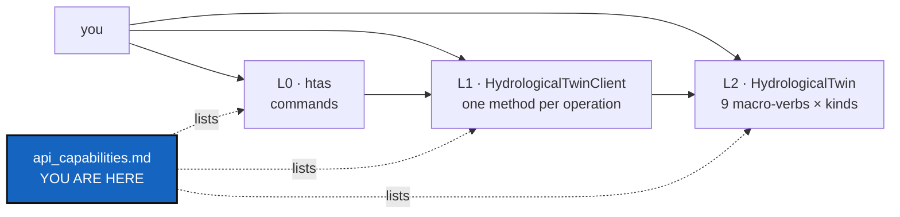

# API capabilities — everything HydrologicalTwinAlphaSeries can do, at each of its three levels

*Created: 2026-04-09*

## Abstract — read this first

**What this document is.** The list of HTAS's public surface: the `htas`
commands (L0), the `HydrologicalTwinClient` operations (L1), and the
`HydrologicalTwin` macro-verbs with every `kind` they accept (L2).

**Why it exists.** A user has to know what HTAS can do before reading how.
This is the one list, kept equal to `src/` by `tests/unit/test_docs_sync.py`:
a method, a verb or a kind that `src/` has and this file does not name
fails the tests.

**What you will find.** The lifecycle, then one section per level, then
the file-based layer provider. Examples are in
[api_examples.md](api_examples.md).

**Who it is for.** Anyone driving HTAS from a script, a notebook or a
shell. CaWaQS-ViZ users never need it.

**What you need to do with it.** Pick the highest level that does the job:
a command, else a client operation, else the verbs.

---

## Lifecycle

A twin moves through `TwinState` in one direction. Each verb checks the
state it needs and raises `InvalidStateError` when called too early.

| Verb | Requires | Moves to |
|---|---|---|
| `configure` | `EMPTY` | `CONFIGURED` |
| `load` | `CONFIGURED` | `LOADED` |
| `describe`, `fetch`, `mask`, `transform`, `assemble`, `render`, `export` | `LOADED` | (unchanged) |

`READY` follows `LOADED` in `TwinState`; no verb moves a twin to it yet.

## Command line (L0)

`htas`, run as `pixi run htas <command> [<subcommand>] [--option ...]`.
Each command calls one `HydrologicalTwinClient` method and prints its
result; `--json` prints it as JSON.

| Command | Calls | Does |
|---|---|---|
| `htas detect run OUT_CAW` | `detect_from_out_caw` | Detects the settings of a CaWaQS output directory; `--write FILE` saves them to a project file |
| `htas detect neighbors QGIS_PROJECT` | `detect_project_neighbors` | Detects the files around a QGIS project; `--write FILE` saves them |
| `htas describe` | `describe` | Builds the twin and lists its compartments |
| `htas budget barplot` | `budget_barplot` | Water-balance budget bar plot and CSV |
| `htas regime show` | `hydrological_regime` | Hydrological regime plot |
| `htas map watbal` | `spatial_map_watbal` | Water-balance map; `--output GPKG` saves it |
| `htas map aq` | `spatial_map_aq` | Aquifer map; `--output GPKG` saves it |
| `htas compare simobs` | `compare_sim_obs` | Simulation against observations: `--mode pdf`, `interactive` or `csv` (`--csv-file` saves the table) |
| `htas criteria compute` | `statistical_criteria` | Statistical criteria at observation points |
| `htas mask internal` | `mask_internal_values` | Values of the cells inside `--polygon`, one `--spec` per series |
| `htas mask hyd` | `mask_hyd_boundary` | River reaches on and inside the polygon's boundary, and their fluxes |
| `htas mask aq` | `mask_aq_boundary` | Aquifer faces on the polygon's boundary, and their fluxes |

The operation commands take the options of their client method, named after
its keyword (`output_dir` is `--output-dir`); the required ones of the method
are required, and one left out is not passed. `htas <command> <subcommand>
--help` lists them, with an example.

- A period is two dates, `--period 2000-01-01 2010-12-31`.
- `--agg` takes `sum`, `mean`, `max`, `min` or a number (a quantile).
- `htas mask` reads its polygon from a vector file (`--polygon FILE`, all its
  features merged; `--polygon-crs` when the file has none) and the simulated
  years from the project file or `--years`.
- `htas mask internal` takes its series as `--spec COMPARTMENT:OUTTYPE:PARAM:UNIT`
  (repeatable), or as `--specs-file`, a JSON list of 4-element lists; both
  may be given.
- `htas map aq` takes its `mode` as `--mode KEY=VALUE` (repeatable; values
  are text, and `null` is `None`) or `--mode-file`, a JSON object. The mode
  needs `kind` (`spatial_map` or `aquifer_outcropping_map`) and `label`, and
  `layer` when `kind=spatial_map`; `layer=null` selects no resolution layer
  for `aquifer_outcropping_map`.
- Yes/no options come in pairs, `--weighted` and `--no-weighted`; left out,
  the client's default applies.
- `--json` prints the result as JSON; data frames appear as their row count
  and columns.

The twin comes from an `htas.toml` project file (`--project`, or the one in
the current directory), and each option overrides one of its keys:
`--out-caw`, `--obs-dir`, `--geometry-config`, `--years START END`, and
`--layer NAME=PATH` (repeatable) for the GIS layers. Exit codes: `0`
the command did what was asked, `1` it ran and the answer is no (a twin in
the wrong state), `2` it could not run: the command
line, a file or the data is not usable. `htas --version` prints the version
and the build.

## Client operations (L1)

`HydrologicalTwinClient` (`HydrologicalTwinAlphaSeries.ht.client`) holds one
twin.

**Construction.**

| Method | Does |
|---|---|
| `build(metadata, configure_kwargs=..., load_kwargs=...)` | Creates the client, then configures and loads its twin. The operations read the simulated period from `metadata["start_year"]` and `metadata["end_year"]` |
| `configure(**kwargs)`, `load(**kwargs)`, `describe()` | The L2 verbs of the same name, on the client's twin |
| `is_ready()` | Whether the twin is loaded |
| `detect_from_out_caw(out_caw_directory)` | The settings found in a CaWaQS output directory |
| `detect_project_neighbors(project_file_path)` | The files found around a QGIS project |

**Operations.** Each one runs a whole fetch → transform → render chain and
returns a `*Result` dataclass (`HydrologicalTwinAlphaSeries.ht.client`).

| Method | Does | Returns |
|---|---|---|
| `budget_barplot` | Water-balance budget bar plot over a period, at a frequency | `BudgetBarplotResult` (`png_path`, `csv_path`) |
| `hydrological_regime` | Hydrological regime plot of a variable at observation points | `HydrologicalRegimeResult` (`png_paths`, `pdf_path`, `savepath`) |
| `spatial_map_watbal` | Spatial map of one water-balance variable | `SpatialMapWatbalResult` (`gdf`, `layer_name`) |
| `spatial_map_aq` | Spatial map of an aquifer variable: head, fluxes, recharge, overflow | `SpatialMapAqResult` (`gdf`, `layer_name`) |
| `compare_sim_obs` | Simulation against observations, as PDF, interactive HTML or CSV data | `CompareSimObsResult` (`mode`, `pdf_path`, `html_path`, `csv_data`, `output_directory`) |
| `statistical_criteria` | Statistical criteria at observation points, written to text files | `StatisticalCriteriaResult` (`points`, `metrics`, `txt_path`, ...) |
| `mask_internal_values` | Time series of the cells inside a polygon, per `(compartment, outtype, param, unit)` spec; optionally a GeoPackage | `MaskInternalValuesResult` (`entries`, `artefacts`, `polygon_total_paths`) |
| `mask_hyd_boundary` | River reaches on and inside a polygon's boundary, and their fluxes | `MaskHydBoundaryResult` (`boundary_gdf`, `inside_gdf`, `flux_gdf`, ...) |
| `mask_aq_boundary` | Aquifer cells on a polygon's boundary and their face fluxes, in `m3/j` or `m3/mois`; optionally a GeoPackage | `MaskAqBoundaryResult` (`entries`, `flux_gdf`, `artefacts`) |

The keyword arguments of each operation are those of its
`operations_client.run_<name>`.

## Developer verbs (L2)

`HydrologicalTwin` (`HydrologicalTwinAlphaSeries`) has nine macro-verbs.
Each takes either a `*Request` dataclass or the same fields as keywords.
The dispatching verbs choose their work by `kind`. `htas-dev` runs them
from the command line (below).

### `configure(...)`

Attaches a `ConfigGeometry`, a `ConfigProject` and the CaWaQS output,
observation and temporary directories (`ConfigureRequest`). No I/O.
Passing both configurations to the constructor configures the twin at once.

### `load(...)`

Builds the compartments named in `ids_compartments` from the layers a
`geo_provider` serves, or registers ready-made `compartments`
(`LoadRequest`). For every `(compartment, outtype)` whose CaWaQS binary
output is present, `load` writes the `.npy` cache of each parameter over
the configured period; files already there for that period are kept, others
are rebuilt. After `load`, `fetch(kind="simulation_matrix")` reads the
cache only, and raises `CacheMissError` when it is missing.

### `describe(...)`

Returns a `TwinDescription`: the state, the compartments, the metadata,
and a `TwinCatalog` of layers, observations, and the kinds and formats a
frontend can offer: `extract_kinds` (`fetch`), `mask_kinds`,
`transform_kinds`, `assemble_kinds`, `render_kinds` and `export_formats`,
all read from `KINDS` (`HydrologicalTwinAlphaSeries.ht.developer`), the one
registry of the dispatching verbs and their kinds (`DescribeRequest`).

### `fetch(...)`

Reads data out of the twin (`FetchRequest`).

- `simulation_matrix`: a simulated variable over a period, from the cache (`ValuesResponse`).
- `observations`: the observations of a compartment.
- `sim_obs_bundle`: simulation and observations paired at each observation point, optionally with criteria (`SimObsBundleResponse`).
- `spatial_map`: a variable aggregated in time, per cell (`SpatialMapResponse`).
- `catchment_cells`: the cells of a catchment (`CellSelectionResponse`).
- `aquifer_outcropping_map`: the aquifer's outcropping cells, with a variable (`SpatialMapResponse`).
- `aq_balance_inputs`: the inputs of an aquifer balance (`AquiferBalanceInputsResponse`).

### `mask(...)`

Selects by a polygon (`MaskRequest`).

- `polygon_cells`: the cells inside the polygon (`CellSelectionResponse`).
- `area_values`: the simulated values of the cells inside the polygon (or of given `cell_ids`), in a target unit, optionally weighted by the share of each cell inside the polygon for a volumetric unit (`ValuesResponse`).
- `boundary_hyd`: the river reaches on the polygon's boundary (`HydBoundaryResponse`).
- `boundary_hyd_flux`: the fluxes through those reaches (`HydBoundaryFluxResponse`).
- `boundary_aq`: the aquifer cell faces on the boundary (`BoundaryFluxResponse`).
- `boundary_aq_flux`: the fluxes through those faces (`BoundaryFluxResponse`).

### `transform(...)`

Computes on data already fetched (`TransformRequest`).

- `temporal_aggregation`: aggregates in time, at a frequency, with an operator.
- `temporal_aggregate`: monthly total volumes.
- `spatial_average`: averages over cells.
- `volumetric_rescale`: rescales a volumetric series to another volumetric unit.
- `criteria`: statistical criteria on a simulation–observation bundle (`CriteriaResponse`).
- `budget`: a budget variable over a period (`BudgetComputationResponse`).
- `hydrological_regime`: the monthly regime (`HydrologicalRegimeResponse`).
- `runoff_ratio`: simulated and observed runoff ratios (`RunoffRatioResponse`).
- `aq_balance`: an aquifer balance (`AquiferBalanceResponse`).

### `assemble(...)`

Shapes blocks already computed into a payload ready to write, with no I/O
(`AssembleRequest`).

- `compartment_bundle`: the bundle of one GeoPackage (`CompartmentBundleResult`).
- `boundary_aq_layers`: the aquifer boundary, one GeoDataFrame per layer (`BoundaryAqLayersResult`).

### `render(...)`

Draws figures and returns the paths written (`RenderRequest`, `RenderResult`).

- `budget_barplot` (alias `budget`): a budget bar plot.
- `hydrological_regime` (alias `regime`): a regime plot.
- `sim_obs_pdf`: simulation against observations, as a PDF.
- `sim_obs_interactive`: the same, as interactive HTML.
- `aq_flux_diagram`: the artefacts of an aquifer balance, from its transformed tables.

### `export(...)`

Writes data already computed to a file, by format (`ExportRequest`,
`ExportResult`). It never computes and never draws.

- `npy`: a NumPy array.
- `geopackage`: a GeoPackage, from an `assemble` bundle.

### Command line (`htas-dev`)

`htas-dev <verb> <kind>`, run as `pixi run htas-dev ...`, calls one verb with
one kind: `fetch`, `mask`, `transform`, `assemble`, `render`, `export`, and
each kind of `KINDS` as a subcommand, written with hyphens
(`htas-dev fetch simulation-matrix`). Its commands and options are generated
from the registry and the request dataclasses, so they follow the code.

- Every field of the verb's request is an option named after it
  (`id_compartment` is `--id-compartment`); one left out is not passed. A
  request field whose name a twin option already uses gets a prefix:
  `--request-years`.
- A number, text, flag or list is parsed. Any other field (an array, a
  mapping, a frame) is read from a file with `--NAME-file`: `.npy`, `.json`,
  or a vector file.
- `--polygon FILE` and `--polygon-crs` read a polygon as `htas mask` does.
- `--output DIR` writes each array (`.npy`), table (`.csv`) and layer
  (GeoPackage) of the result into `DIR`, so a result can feed the next command
  with `--data-file`. In `--json`, an array of more than 1000 values appears
  as its shape.
- The twin is built like `htas` builds it (project file, `--out-caw`,
  `--obs-dir`, `--geometry-config`, `--years`, `--layer`), and the exit codes
  are the same. A kind that needs an in-memory result of an earlier step (a
  simulation-observation bundle, aquifer inputs) cannot be fed from files.

## File-based layer provider

`FileGeoProvider({layer_name: path})` (`HydrologicalTwinAlphaSeries.services.public`)
serves the GIS layers `load` needs from files, with geopandas and no QGIS.
Pass it as `geo_provider` to `load`; `htas` builds one from `--layer`.

## Transport

HTAS is a Python library and a command line. It has no HTTP interface.
