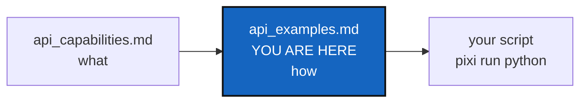

# API examples — short HydrologicalTwinAlphaSeries snippets to copy

*Created: 2026-04-02*

## Abstract — read this first

**What this document is.** Working snippets for each level of HTAS: the
command line, the client operations, and the developer verbs.

**Why it exists.** [api_capabilities.md](api_capabilities.md) says what
HTAS can do; this file shows the calls. `tests/unit/test_docs_sync.py`
checks every snippet against `src/`: its imports, its methods, its keyword
arguments and its kinds.

**What you will find.** Building a twin, one client operation, then the
verbs, then the file-based provider and the command line.

**Who it is for.** Anyone scripting HTAS. The paths are placeholders.

**What you need to do with it.** Replace the paths and the compartment
numbers with your project's.



---

Compartments are numbered as CaWaQS numbers them: `1` AQ (aquifer), `2`
HYD (river network), `3` WATBAL (surface water balance), `4` NSAT.

## Building a twin

```python
from HydrologicalTwinAlphaSeries.config import ConfigGeometry, ConfigProject
from HydrologicalTwinAlphaSeries.ht.client import HydrologicalTwinClient
from HydrologicalTwinAlphaSeries.services.public import FileGeoProvider

config_geom = ConfigGeometry.fromJsonFile("/data/geometry.json")
config_proj = ConfigProject.fromDict(
    {
        "json_path_geometries": "/data/geometry.json",
        "projectName": "demo",
        "cawOutDirectory": "/data/OUT_CAW",
        "startSim": 2000,
        "endSim": 2010,
        "obsDirectory": "/data/OBS",
        "regime": "Transient",
    }
)

client = HydrologicalTwinClient.build(
    {"project_name": "demo", "start_year": 2000, "end_year": 2010},
    configure_kwargs={
        "config_geom": config_geom,
        "config_proj": config_proj,
        "out_caw_directory": "/data/OUT_CAW",
        "obs_directory": "/data/OBS",
    },
    load_kwargs={"geo_provider": FileGeoProvider({"AQ_LAYER": "/data/gis/aq.gpkg"})},
)

print(client.is_ready())
print(client.describe().compartments)
```

The client operations read the simulated period from the metadata:
`start_year` and `end_year` are required.
`HydrologicalTwinClient.detect_from_out_caw("/data/OUT_CAW")` returns the
settings it can find in a CaWaQS output directory, to fill the dictionaries
above.

## One client operation

```python
result = client.budget_barplot(
    period=("2000-01-01", "2010-12-31"),
    frequency="Y",
    agg="sum",
    pluriannual=False,
    output_dir="/data/out",
)

print(result.png_path, result.csv_path)
```

## The developer verbs

```python
from HydrologicalTwinAlphaSeries import HydrologicalTwin
from HydrologicalTwinAlphaSeries.ht import FetchRequest, TransformRequest

twin = HydrologicalTwin(
    config_geom=config_geom,
    config_proj=config_proj,
    out_caw_directory="/data/OUT_CAW",
    obs_directory="/data/OBS",
)
twin.load(geo_provider=FileGeoProvider({"AQ_LAYER": "/data/gis/aq.gpkg"}))

values = twin.fetch(
    request=FetchRequest(
        kind="simulation_matrix",
        id_compartment=1,
        outtype="MB",
        param="recharge",
        syear=2000,
        eyear=2010,
    )
)
print(values.data.shape, values.dates[:3])

monthly = twin.transform(
    request=TransformRequest(
        kind="temporal_aggregation",
        data=values.data,
        dates=values.dates,
        frequency="Monthly",
        agg_dimension="mean",
    )
)

catalog = twin.describe().catalog
print(catalog.extract_kinds, catalog.transform_kinds, catalog.render_kinds)
```

## The developer verbs from the command line

```bash
pixi run htas-dev fetch simulation-matrix --project htas.toml --id-compartment 1 --outtype MB --param recharge --syear 2000 --eyear 2010 --output /data/out/recharge
pixi run htas-dev transform temporal-aggregation --project htas.toml --data-file /data/out/recharge/data.npy --dates-file /data/out/recharge/dates.npy --frequency Monthly --agg-dimension mean --output /data/out/monthly
pixi run htas-dev mask polygon-cells --project htas.toml --id-compartment 1 --polygon /data/area.gpkg
```

## File-based provider and the command line

```python
from HydrologicalTwinAlphaSeries.services.public import FileGeoProvider

provider = FileGeoProvider({"AQ_LAYER": "/data/gis/aq.gpkg"})
print(provider.layer_names)
```

```bash
pixi run htas detect run /data/OUT_CAW --write htas.toml
pixi run htas detect neighbors /data/project.qgz --write htas.toml
pixi run htas describe --project htas.toml --layer AQ_LAYER=/data/gis/aq.gpkg
pixi run htas describe --project htas.toml --json
pixi run htas budget barplot --period 2000-01-01 2010-12-31 --frequency Y --agg sum --output-dir /data/out
pixi run htas mask internal --polygon /data/area.gpkg --spec AQ:MB:recharge:m3/j --output-dir /data/out --temp-dir /data/tmp --area-name basin
```
