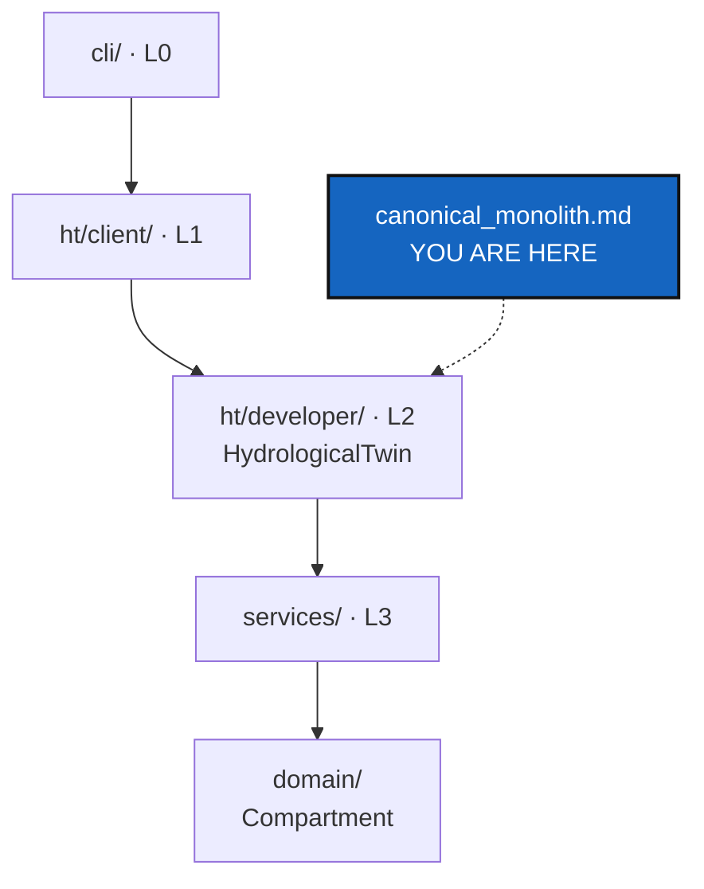

# Canonical monolith — HydrologicalTwinAlphaSeries is one object, and its rules

*Created: 2026-04-09*

## Abstract — read this first

**What this document is.** The architectural invariant of HTAS: one facade
object over compartments, the layers behind it, its lifecycle, and the
rules that keep it that way.

**Why it exists.** HTAS is deliberately monolithic: no plugin, no loose
extension point. The rules below are what lets CaWaQS-ViZ, a script and the
command line all see the same backend.

**What you will find.** The invariant, the entry points, the layers, the
nine macro-verbs, the lifecycle, the rules.

**Who it is for.** Developers, and anyone deciding where new code goes.

**What you need to do with it.** Check a change against *Rules* before
writing it.



---

## Core invariant

> HTAS exposes one canonical object, `HydrologicalTwin`, which manages a
> domain made of `Compartment` aggregates. Every public operation acts on
> compartments, never on low-level artefacts directly.

## Entry points

```python
from HydrologicalTwinAlphaSeries import HydrologicalTwin
from HydrologicalTwinAlphaSeries.ht.client import HydrologicalTwinClient
```

`HydrologicalTwinClient` holds one `HydrologicalTwin` and offers one method
per CaWaQS-ViZ operation; the `htas` command line calls the client. See
[api_capabilities.md](api_capabilities.md).

## Layers

| Layer | Package | Purpose |
|---|---|---|
| L0 | `cli/` | Command line: collects arguments, calls the client, prints |
| L1 | `ht/client/` | One method per operation, chaining the verbs; `*Result` types |
| L2 | `ht/developer/` | The facade, its verbs, their dispatch on `kind`; `*Request`/`*Response` types |
| L3 | `services/` | Operations, with no global state |
| | `domain/` | State and entities, no orchestration ([domain_model.md](domain_model.md)) |
| | `config/`, `tools/` | Configuration models and constants; generic utilities |

Imports point downward only. The full layout is in
[developer_guide.md](developer_guide.md).

## The nine macro-verbs

| Verb | Purpose |
|---|---|
| `configure` | Attach the project and geometry configuration |
| `load` | Build and register the compartments, and cache the simulation outputs |
| `describe` | Return the twin's description and its catalog |
| `fetch` | Read data out of the twin, by `kind` |
| `mask` | Select by a polygon: cells, values, boundaries, by `kind` |
| `transform` | Compute on fetched data, by `kind` |
| `assemble` | Shape computed blocks into a payload ready to write, by `kind` |
| `render` | Draw figures, by `kind` |
| `export` | Write data files (`npy`, `geopackage`), by `kind` |

Each verb checks the lifecycle. `configure`, `load` and `describe` act in
the facade itself; each of the six other verbs builds its request and hands
it to `dispatch.py`, which calls `services/` and `domain/` for the work.

## Lifecycle

```
EMPTY → CONFIGURED → LOADED → READY
```

- **EMPTY**: created, no configuration.
- **CONFIGURED**: configuration attached, nothing loaded.
- **LOADED**: compartments registered, outputs cached; every verb works.
- **READY**: follows `LOADED` in `TwinState`; no verb moves a twin to it yet.

A verb called before the state it needs raises `InvalidStateError`.

## Rules

- `Compartment` is the primary aggregate; operations flow through it.
- `domain/` holds state, no orchestration. `services/` holds operations, no
  global state. `tools/` holds utilities with no domain meaning.
- The public API takes and returns structured types (`*Request`,
  `*Response`, `*Result` dataclasses).
- External code goes through the client or the facade and never calls
  `services/` directly; the one exception is `FileGeoProvider`
  (`services.public`), the layer provider it passes to `load`. Compartments
  are built by `load`; `load(compartments=...)` registers compartments built
  beforehand, for tests and advanced use.
- No module under `src/` imports QGIS or PyQt
  (`tests/unit/test_qgis_free.py`).

## Transport

HTAS has no web framework and no HTTP interface. The Python API and the
`htas` command line are its only contracts.
