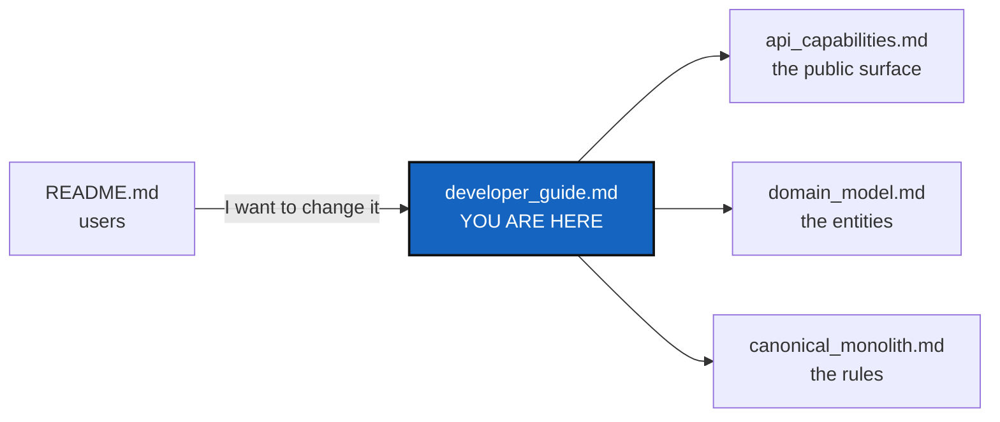
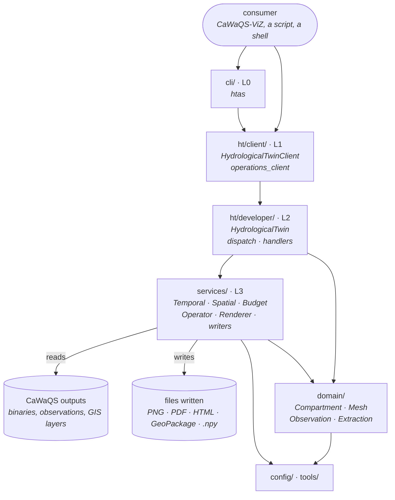

# Developer guide — how HydrologicalTwinAlphaSeries is built, and how to work on it

*Created: 2026-11-20*

## Abstract — read this first

**What this document is.** The contributor's view of HTAS: what each package
under `src/` holds, how the packages call each other, how to set up a
working checkout, and how to work on HTAS and CaWaQS-ViZ together.

**Why it exists.** The root [README](../README.md) is for users. What a
contributor needs (the layout, the layers, the submodule recipes) is
gathered here so the README can stay short.

**What you will find.** §1 setting up. §2 the repository and its layers.
§3 the conceptual diagram. §4 working with CaWaQS-ViZ.

**Who it is for.** Anyone changing HTAS's code. Read the README first.

**What you need to do with it.** Set up once (§1). When a change moves a
responsibility between packages, update §2 and §3 in the same change.



---

## 1. Setting up

```bash
pixi install          # the environment
pixi run dev-setup    # once per clone: the pre-commit hook (ruff on staged files)
pixi run lint         # ruff check src tests
pixi run test         # pytest: tests/unit and tests/integration
```

There is no CI. `pixi run lint` and `pixi run test` are the gate, run on
your machine before every commit. The test suite includes the QGIS-free
guard (`tests/unit/test_qgis_free.py`) and the documentation drift tests
(`tests/unit/test_docs_sync.py`). The smoke test on real CaWaQS data runs
when `CWAQS_FIXTURE_ROOT` points to the public test case, and is skipped
otherwise ([tests/README.md](../tests/README.md)).

Python work always goes through Pixi, never bare `pip` or a virtual
environment.

## 2. The repository and its layers

Imports point downward only: a package never imports one above it.

| Layer | Package | Holds |
|---|---|---|
| L0 | `cli/` | The `htas` command line. `__init__.py` holds the parser and `COMMANDS`, the one registry of commands; `twin.py` the `detect` and `describe` commands; `operations.py` the commands that mirror the nine client operations, from one table of options; `project.py` reads and writes `htas.toml`; `suggest.py` the "did you mean"; `exit_codes.py` the exit codes. Each command calls one `HydrologicalTwinClient` method and prints. |
| L1 | `ht/client/` | `HydrologicalTwinClient` (`hydrological_twin_client.py`), one method per CaWaQS-ViZ operation. `operations_client.py` chains the verbs of L2 for each operation (`run_budget_barplot`, ...). `api_types.py` holds the `*Result` dataclasses. |
| L2 | `ht/developer/` | `HydrologicalTwin` (`hydrological_twin_developer.py`), the facade and its nine verbs. `dispatch.py` routes each verb on its `kind`; `handlers.py` holds the computations it calls; `api_types.py` the `*Request` and `*Response` dataclasses and `TwinState`. |
| L3 | `services/public/` | The operators: `temporal.py` (`Temporal`: reading CaWaQS binaries, the `.npy` cache, temporal aggregation), `spatial.py` (`Spatial`), `budget.py` (`Budget`), `vec_operator.py` (`Operator`, `Extractor`, `Comparator`), `renderer.py` (`Renderer`), `polygon_mask.py`, `geodata_assembly.py`, `twin_io.py` (reads over the twin's state), `io_types.py`, `metrics_spec.py`, `automatic_detection_config.py` (detection), `file_geo_provider.py` (`FileGeoProvider`). |
| L3 | `services/private/` | The internal-only code that handles raw data: `submodel_export.py`, the NumPy and GeoPackage writers `export` calls, and `raw_data_export.py`, which assembles the daily simulation–observation table of `compare_sim_obs`. |
| | `domain/` | The entities: `Compartment` (and `GeoLayerProvider`, the interface a layer provider fills), `Mesh`, `Observation` and `ObsPoint`, `Extraction` and `ExtractionPoint`, `TimeFrame`. |
| | `config/` | `Config`, `ConfigGeometry`, `ConfigProject` (`models.py`), `FactoryClass` (`factory.py`), and `constants.py`. |
| | `tools/` | `spatial_utils.py`: CRS checks, nearest-cell queries, the HYD correspondence file. |

Next to `src/`: `tests/unit/` and `tests/integration/`, `scripts/bump_build.py`
(the build counter, `__build__`), and `docs/`.

## 3. The conceptual diagram

How the packages connect, what comes in from outside (a consumer, the
CaWaQS output files) and what goes out (figures and data files). Solid
arrows are imports, in the direction of the dependency.



- A consumer reaches HTAS through `cli/` or `ht/client/`. Developers may
  call `HydrologicalTwin` directly.
- `domain/` depends only on `config/` and `tools/`, so the entity model
  stays usable without the facade.
- `services/` does the heavy I/O: `Temporal` reads the CaWaQS binaries and
  keeps the `.npy` cache, `Renderer` writes figures, and
  `submodel_export.py` writes data files. Three other places touch the
  disk: `operations_client.py` writes the CSV and text files of the client
  operations (and `handlers.py` an HTML report), `domain/Mesh.py` reads the
  HYD correspondence file, and `cli/project.py` reads and writes
  `htas.toml`.

## 4. Working with CaWaQS-ViZ

CaWaQS-ViZ (frontend, GitLab) carries HTAS (backend, GitHub) as a Git
submodule at `external/HydrologicalTwinAlphaSeries`. There are three
scenarios, depending on where the change is.

1. **Frontend only.** Branch on the GitLab repository (CaWaQS-ViZ). The
   submodule is not affected.
2. **Backend only, with no CaWaQS-ViZ test needed.** Branch on the GitHub
   repository (HTAS). The frontend is updated after the merge.
3. **Frontend and backend together**, or a backend change tested through
   CaWaQS-ViZ as it goes: open **two branches with the same name**, one on
   each side, as below.

**Once per coordinated branch.**

```bash
cd external/HydrologicalTwinAlphaSeries
git checkout <branch-name>              # 1. the submodule on the branch
git add <files>                         # 2. after backend edits: commit and push
git commit -m "<backend commit message>"   #    inside the submodule first
git push origin <branch-name>
cd -
git add external/HydrologicalTwinAlphaSeries     # 3. then record the new pointer
git commit -m "Track backend branch <branch-name>"   #    in CaWaQS-ViZ
```

Commit the pointer often: it keeps the frontend on the latest backend and
avoids large jumps that are hard to debug.

**Or track the branch in `.gitmodules`.** The `branch` field tells
`git submodule update --remote` which remote branch to follow:

```ini
[submodule "external/HydrologicalTwinAlphaSeries"]
    branch = <branch-name>
```

```bash
git submodule update --remote external/HydrologicalTwinAlphaSeries
git add external/HydrologicalTwinAlphaSeries
git commit -m "Update submodule to latest <branch-name>"
```

`--remote` only moves the submodule's working tree; `git add` and
`git commit` in CaWaQS-ViZ still record the pointer. When both branches are
merged, set the field back to `main`:

```ini
[submodule "external/HydrologicalTwinAlphaSeries"]
    branch = main
```

| Term | Meaning |
|---|---|
| **Submodule pointer** | A commit hash stored in the parent repository. It pins the exact backend version used, and does not move on its own. |
| `.gitmodules` `branch` field | The remote branch `git submodule update --remote` fetches. It has no effect without `--remote`. |
| **Detached HEAD** | The normal state of a submodule: it checks out a commit, not a branch. |
