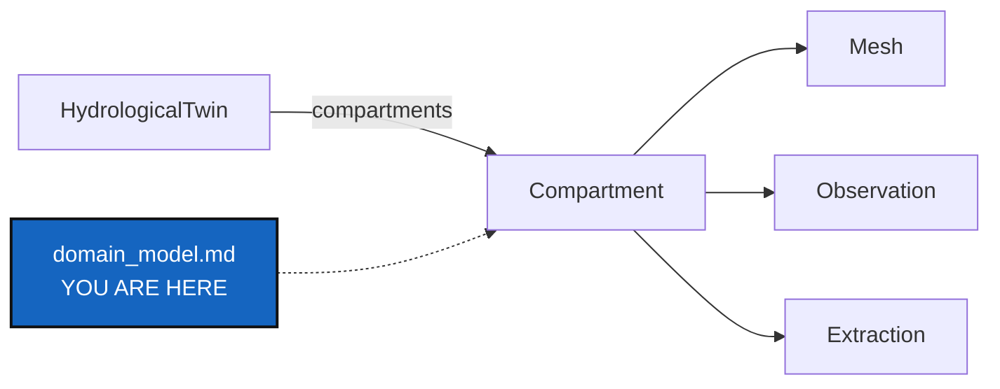

# Domain model — the compartment-centric entities of HydrologicalTwinAlphaSeries

*Created: 2026-04-09*

## Abstract — read this first

**What this document is.** The entities of `domain/`: what a `Compartment`
holds and how the twin holds compartments.

**Why it exists.** Every HTAS operation acts on compartments. Knowing what
a compartment carries explains what each operation can be asked.

**What you will find.** The core rule, the entities, their diagram, how
compartments reach the twin.

**Who it is for.** Developers, and users of the L2 verbs.

**What you need to do with it.** Nothing, unless you change `domain/`: then
update this file in the same change.



---

## The core rule

`Compartment` is the primary aggregate. Public operations act on
compartments, never on a mesh, an observation or an extraction point
directly.

## The entities

**`Compartment`** (`domain/Compartment.py`): one CaWaQS compartment,
numbered as CaWaQS numbers them (`1` AQ, `2` HYD, `3` WATBAL, `4` NSAT;
`module_caw` in `config/constants.py`). It is built from a `ConfigGeometry`,
a `ConfigProject`, the CaWaQS output and observation directories, and a
layer provider (any object with `get_layer(name)`, the `GeoLayerProvider`
protocol, such as `FileGeoProvider`).

| Attribute | Type | Cardinality | Holds |
|---|---|---|---|
| `mesh` | `Mesh` | 1 | The spatial support: layers of cells |
| `obs` | `Observation` | 0..1 | The observation points and their time series |
| `extraction` | `Extraction` | 0..1 | The extraction points |

**`Mesh`** (`domain/Mesh.py`): its `mesh` attribute maps a layer number to
a `Mesh.Layer`; each layer holds its cells, `Mesh.Layer.Cell`, with their
geometry and identifiers.

**`Observation`** (`domain/Observations.py`): the observation points of a
compartment, `obs_points`, a list of `ObsPoint`, each linked to a cell of
the compartment's mesh.

**`Extraction`** (`domain/Extraction.py`): named extraction points,
`ext_point`, a list of `ExtractionPoint`, each linked to a cell of the
mesh.

**`TimeFrame`** (`domain/timeframe.py`): a period, `date_ini` (inclusive)
to `date_end` (exclusive), with a `timestep` (`"daily"` or `"monthly"`).
It is defined for analysis periods; no compartment holds one yet.

## The diagram

```
HydrologicalTwin
  └── compartments : Dict[int, Compartment]
        ├── mesh       : Mesh (1)
        │     └── mesh : Dict[int, Mesh.Layer]
        │           └── layer : List[Mesh.Layer.Cell]
        ├── obs        : Observation (0..1)
        │     └── obs_points : List[ObsPoint]
        └── extraction : Extraction (0..1)
              └── ext_point : List[ExtractionPoint]
```

## How compartments reach the twin

`load` builds them, from the compartment numbers and a layer provider:

```python
twin.load(ids_compartments=[1, 2, 3], geo_provider=provider)
```

`load(compartments={...})` registers compartments built beforehand. After
`load`, every verb acts on `twin.compartments`. `domain/` imports only
`config/` and `tools/`, never `services/` or `ht/`.
