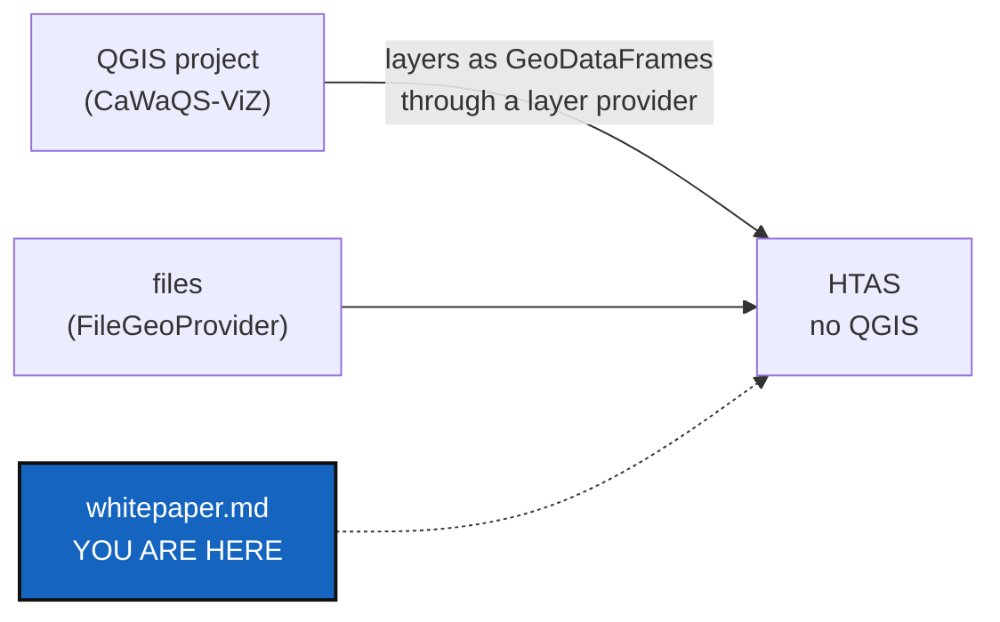

# Architecture notes — HydrologicalTwinAlphaSeries and CaWaQS-ViZ

*Created: 2026-04-02*

## Abstract — read this first

**What this document is.** Where the line between HTAS (the backend) and
CaWaQS-ViZ (the QGIS plugin) runs, and how the two repositories fit
together.

**Why it exists.** HTAS was cut out of CaWaQS-ViZ. Which side owns what,
QGIS layers in particular, is the question every change across the two
asks first.

**What you will find.** The boundary, the layer provider that crosses it,
and the repository layout.

**Who it is for.** Developers working on either side. The scientific
framework HTAS belongs to is described in the White Book, in
`docs/hydrological_twin`.

**What you need to do with it.** Keep QGIS on the CaWaQS-ViZ side.

---

## The boundary

HTAS never imports CaWaQS-ViZ, QGIS or PyQt
(`tests/unit/test_qgis_free.py`). Whatever needs QGIS stays in CaWaQS-ViZ.

The one thing HTAS needs from GIS is a layer: `load` asks a *layer
provider* for each layer by name, through `get_layer(name)`, and receives a
GeoDataFrame (the `GeoLayerProvider` protocol, `domain/Compartment.py`).
CaWaQS-ViZ passes a provider that reads QGIS layers; outside QGIS,
`FileGeoProvider` (`services/public/file_geo_provider.py`) reads them from
files.

CaWaQS-ViZ calls HTAS through `HydrologicalTwinClient`, one method per
dialog operation, and receives typed results ([api_capabilities.md](api_capabilities.md)).

## The repositories

- `HydrologicalTwinAlphaSeries`: this repository, the backend, on GitHub.
- CaWaQS-ViZ, the plugin, on GitLab, carries HTAS as a Git submodule at
  `external/HydrologicalTwinAlphaSeries`
  ([developer_guide.md](developer_guide.md) §4).

The package layers are in [developer_guide.md](developer_guide.md) §2.
