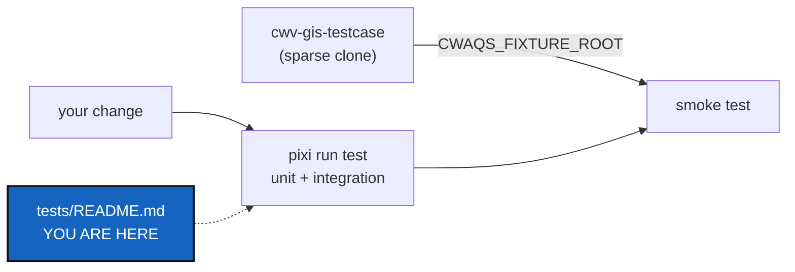

# HTAS tests — what runs, and the smoke test on real CaWaQS data

*Created: 2026-05-11*

## Abstract — read this first

**What this document is.** How HydrologicalTwinAlphaSeries's test suite is
laid out, how to run it, and how the one test on real data gets its data.

**Why it exists.** Most tests need nothing. The smoke test needs a public
CaWaQS test case, fetched by hand: this file is its recipe.

**What you will find.** The layout, running the suite, the smoke test and
its fixture, and what ages.

**Who it is for.** Developers. There is no CI: this suite, run on your
machine before every commit, is the gate.

**What you need to do with it.** Run `pixi run test` before every commit.
Fetch the fixture once to run the smoke test too.



---

## Layout

| Directory | Holds |
|---|---|
| `tests/unit/` | Pure unit and facade tests, with `services/` and `tools/` subpackages. Among them: `test_qgis_free.py`, the guard that no module under `src/` imports QGIS or PyQt, and `test_docs_sync.py`, the drift tests that hold the documents to `src/`. |
| `tests/integration/` | The facade lifecycle, and smoke runs on real CaWaQS meshes. |

```bash
pixi run test                 # the whole suite
pixi run test -m "not slow"   # without the slow runs
pixi run lint                 # ruff check src tests
```

Tests that need real data skip cleanly when it is absent: the smoke test
without `CWAQS_FIXTURE_ROOT`, and `test_aq_boundary_faces_real_meshes.py`
without its meshes. No test reaches the network.

## The smoke test on real CaWaQS data

`integration/test_cwv_gis_smoke.py` walks the macro API on a real, light
CaWaQS output, the `cwv-gis-testcase` fixture:

```
configure  →  load  →  describe  →  fetch  →  transform  →  render
```

It asserts two things: no step raises, and `render(kind="budget_barplot")`
writes a PNG. It detects crashes when real data goes through the public
API. It is not a numerical regression test: it checks no shapes, values,
tolerances or pixels.

### Running it

From the HTAS repository root (inside CaWaQS-ViZ, that is
`external/HydrologicalTwinAlphaSeries`):

```bash
# 1. Fetch the fixture once (only this subdirectory matters)
git clone --depth 1 --filter=blob:none --sparse \
    --branch v0.1-cwv-gis-smoke-CI \
    https://gitlab.com/cawaqs/gtest/testcases.git /tmp/cawaqs-testcases
git -C /tmp/cawaqs-testcases sparse-checkout set datasets/cwv-gis-testcase

# 2. Point the test at it, and run it: it passes and writes a PNG
export CWAQS_FIXTURE_ROOT=/tmp/cawaqs-testcases/datasets/cwv-gis-testcase
pixi run test tests/integration/test_cwv_gis_smoke.py -v

# 3. Without the variable, it is SKIPPED, not FAILED
unset CWAQS_FIXTURE_ROOT
pixi run test tests/integration/test_cwv_gis_smoke.py -v
```

The fixture is pinned by a git tag, `v0.1-cwv-gis-smoke-CI`, because tags
do not move. To use a newer version of the test case, change the tag here.

### What ages

- **The fixture tag**, above, when the test case evolves.
- **The macro API signatures the test calls** (`configure`, `load`,
  `describe`, `fetch`, `transform`, `render`). A renamed keyword, a removed
  kind or a restructured response breaks the test, on purpose: fix it in
  the same change. The test does not depend on `services/`, `domain/`, or
  any shape or value.

### Its own layer provider

`load` needs an object with `get_layer(name)` returning a GeoDataFrame. The
smoke test defines a small one inline, `_SmokeGeoProvider`, which reads each
layer from its file with geopandas. HTAS also ships `FileGeoProvider`
(`services/public/file_geo_provider.py`), which does the same; the test
keeps its own so that it depends on nothing beyond the macro API.
